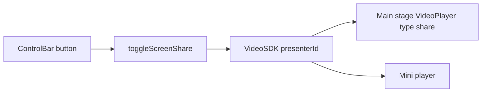

# Screen share with VideoSDK

Screen share is already available on `@videosdk.live/react-sdk` (`^1.1.1`). `useMeeting()` returns `toggleScreenShare`, `localScreenShareOn`, and `presenterId`. `useParticipant()` returns `screenShareOn`, `screenShareStream`, and `setScreenShareQuality`. `VideoPlayer` with `type="share"` attaches that track.

Mic and camera stay as they are. Sharing starts only from the button click, because the browser display picker must come from a user gesture. The button follows `localScreenShareOn` after the promise settles, so cancelling the picker does not leave the control stuck on.



## Layout

When `presenterId` is set, the main stage shows that share. The doctor's camera stays in the existing local tile. When nobody is sharing, the stage stays the patient camera. The mini player uses the same rule so the share stays visible after leaving the meeting route.

## 1. Toggle in the media hook

In [hooks/commons/meeting/useMeetingMedia.ts](hooks/commons/meeting/useMeetingMedia.ts), read `localScreenShareOn` and `toggleScreenShare` from `useMeeting()`. Do not store this in Zustand. Mic and camera are stored because they seed the next join; share always starts off.

```ts
const { localScreenShareOn, toggleScreenShare } = useMeeting();

const handleToggleScreenShare = useCallback(async () => {
  try {
    await toggleScreenShare();
  } catch (error) {
    console.warn("Screen share failed:", error);
  }
}, [toggleScreenShare]);

return {
  // existing mic/camera fields
  isScreenShareOn: Boolean(localScreenShareOn),
  toggleScreenShare: handleToggleScreenShare,
};
```

Leaving the meeting already calls `leave()`, which stops the published share.

## 2. Control bar button

In [components/Modules/MeetingModule/MeetingControlBar.tsx](components/Modules/MeetingModule/MeetingControlBar.tsx), add the button after the camera controls, using MUI `ScreenShare` and `StopScreenShare` like the other call icons.

```tsx
const { isScreenShareOn, toggleScreenShare } = useMeetingMedia();

<Tooltip title={isScreenShareOn ? "Stop sharing" : "Share screen"}>
  <IconButton
    className={`control-btn${isScreenShareOn ? " is-sharing" : ""}`}
    onClick={toggleScreenShare}
    aria-label={isScreenShareOn ? "Stop sharing" : "Share screen"}
  >
    {isScreenShareOn ? <StopScreenShareIcon /> : <ScreenShareIcon />}
  </IconButton>
</Tooltip>;
```

In the participants popover, show a small screen icon when `participant.screenShareOn` is true, next to the existing mic and camera icons.

## 3. Show the share on the stage

In [components/Modules/MeetingModule/MeetingStage.tsx](components/Modules/MeetingModule/MeetingStage.tsx), read `presenterId` and `localParticipant` from `useMeeting()` and pass them into the remote stage.

In [components/Modules/MeetingModule/RemoteStage.tsx](components/Modules/MeetingModule/RemoteStage.tsx), when `presenterId` is set, render the share instead of the webcam. Request high share quality the same way the webcam already calls `setQuality('high')`.

```tsx
const shareParticipant = useParticipant(presenterId || '');
const { screenShareOn, setScreenShareQuality } = shareParticipant || {};

useEffect(() => {
  if (!presenterId || !screenShareOn || typeof setScreenShareQuality !== 'function') return;
  setScreenShareQuality('high').catch((error) => {
    console.warn('Unable to request high screen-share quality:', error);
  });
}, [presenterId, screenShareOn, setScreenShareQuality]);

// inside the video area, ahead of the webcam branch
{presenterId && screenShareOn ? (
  <VideoPlayer
    participantId={presenterId}
    type="share"
    className="remote-player"
    classNameVideo="remote-player-video"
  />
) : /* existing waiting / camera-off / webcam branches */}
```

Add a short overlay label on the stage: "You are sharing your screen" when `presenterId === localParticipant.id`, otherwise "Patient is sharing their screen".

## 4. Mini player

In [components/Modules/MeetingModule/MeetingMiniPlayer.tsx](components/Modules/MeetingModule/MeetingMiniPlayer.tsx), if `presenterId` is set, render `VideoPlayer` with `type="share"` for that participant. Otherwise keep the current webcam or avatar. Add the same share toggle beside mic and camera, reusing `useMeetingMedia`.

## 5. Styles

In [styles/CustomStyled/MeetingWrapper.tsx](styles/CustomStyled/MeetingWrapper.tsx), add `.control-btn.is-sharing` and `.mini-btn.is-sharing` with `brandTeal` so an active share is distinct from the red muted state. Add a small `.share-label` on the stage (top-left, same pill family as the timer). `object-fit: contain` is already set on `.remote-player-video`, which is the right fit for a screen.

## Verification

- Click Share screen, pick a display, confirm the stage shows it and the button switches to Stop sharing.
- Cancel the browser picker and confirm the button stays off.
- Stop from the button and from the browser's own "Stop sharing" control.
- With a second participant, confirm their share replaces the main camera and the local camera tile stays.
- Leave the meeting route and confirm the mini player shows the share and can stop it.
