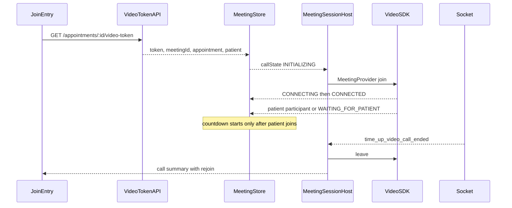

# Web video calling plan

All work is in the web repo, [webdoctornext](/Users/pred/Documents/PredCare/webdoctornext). The mobile app at `predcaredoctor` is already working and is only a behavior reference. No file in that app will be edited.

The web meeting page is a static layout today. Join still calls `showInDevelopment()`, and the stage shows a hardcoded patient, a fake timer (`4:53`), and a fake network reading (`NET: GOOD 75.34/79.8`). The token endpoint already exists. VideoSDK and the socket client do not.

## Packages

Install these two. Everything else is already in [package.json](package.json).

- `@videosdk.live/react-sdk` — web meeting SDK. Provides `MeetingProvider`, `useMeeting`, and `useParticipant`. Renders into a normal `<video>` element. This is the web package. Do not install `@videosdk.live/react-native-sdk` or `@videosdk.live/react-native-incallmanager`. Those belong to the mobile app.
- `socket.io-client@^4.8.4` — same major version the working app uses. Used only for `incoming_call`, `incoming_call_cancelled`, `call_connected`, and `time_up_video_call_ended`.

Already installed, and used as-is:

- `next@16.4.0` and `react@19.3.0` — meeting UI is a client component under the dashboard layout. The VideoSDK provider is loaded only on the client so it never runs during server render.
- `zustand@^5.0.15` — call state, incoming-call banner, and socket connection.
- `@tanstack/react-query@^5` and `axios` — existing `GET /appointments/:id/video-token` client. Join uses a mutation so the token request runs on click.
- `@mui/material` and `@mui/icons-material` — stage, control bar, side panel, banner, and summary. Styles stay in the existing `MeetingWrapper`.
- `sonner` — permission errors, the 2-minute warning, and the time-up message, through the existing toast helpers.

No other video, WebRTC, or screen-share package. Browser `getUserMedia` is used only to ask for camera and microphone before join.

## Web behavior to match

The working app joins VideoSDK with `GET /appointments/:id/video-token`. The web call follows that same sequence inside this repo.



Call states stored in the new web file `zustand/interfaces/meeting.interfaces.ts`: `IDLE`, `INITIALIZING`, `CONNECTING`, `WAITING_FOR_PATIENT`, `CONNECTED`, `RECONNECTING`, `DISCONNECTED`, `FAILED`, `ENDED`.

Web controls: mute, camera, camera switch, prescription, upload, minimize, end. The stage shows patient name, connected or waiting, remaining time, and a network label (`Offline`, `Weak`, `Fair`, `Good`, `Strong`). A toast fires at 2 minutes left. Time-up comes from the socket event `time_up_video_call_ended`, which leaves the SDK session.

Join is reused from home, appointment list, appointment details, patient consults, the incoming-call banner, and the post-call summary. If that appointment is already the active meeting, join only restores the meeting instead of requesting a new token.

## Out of scope

- The mobile app. `predcaredoctor` is not part of this work.
- Screen sharing. Remove the Share screen control from [MeetingStage.tsx](components/Modules/MeetingModule/MeetingStage.tsx). Do not call `getDisplayMedia`. Do not add a screen-share package.
- Participants list and reactions. Those buttons exist only on the web mock. The doctor call does not implement them, so they come off the control bar.
- Android native picture-in-picture, foreground service, camera-capture handoff, and front/back camera flip. Web uses a floating mini player while the doctor stays inside the dashboard, and a camera-device switch only when the browser reports more than one camera.
- Heartbeat and `save-call`. Both apps already define those endpoints, and the mobile meeting screen never calls them. Call end is SDK `leave` plus the time-up socket.

## What already exists on web

- Route: [app/(dashboard)/dashboard/meeting/page.tsx](<app/(dashboard)/dashboard/meeting/page.tsx>) renders [MeetingPage.tsx](components/Modules/MeetingModule/MeetingPage.tsx), which is stage plus side panel. Styles live in [MeetingWrapper.tsx](styles/CustomStyled/MeetingWrapper.tsx).
- Token, heartbeat, and save-call clients already exist in [appointments.func.ts](hooks/react-query/appointments/appointments.func.ts) and [endpoints.ts](services/api/endpoints.ts). `useApptToken` is a query; join should use a mutation so it runs only on click.
- [IGetApptTokenDoc](typescripts/interfaces/appointments.interfaces.ts) is missing `patient` and `call_elapsed_seconds`. The countdown needs both, matching the mobile token type.
- Join buttons in [AppointmentListPage.tsx](components/Modules/AppointmentsModule/AppointmentListPage.tsx) and [TodayAppointmentsTable.tsx](components/Modules/DahsboardModule/TodayAppointments/TodayAppointmentsTable.tsx) are stubs. A video row can start when status is `confirmed` or in progress.
- No socket layer. The doctor app connects `socket.io` to the API base URL with the auth token and listens for `incoming_call`, `incoming_call_cancelled`, `call_connected`, and `time_up_video_call_ended`.

## Folder structure

New files are marked. Existing files stay in place and get wired.

```text
app/(dashboard)/dashboard/meeting/
  page.tsx                          existing live-call route
  summary/page.tsx                  new post-call summary

components/Modules/MeetingModule/
  MeetingPage.tsx                   existing layout
  MeetingStage.tsx                  remote video, status, controls
  MeetingSidePanel.tsx              live patient profile
  MeetingSessionHost.tsx            new VideoSDK provider, mounted in dashboard layout
  RemoteStage.tsx                   new patient video or waiting state
  LocalVideoTile.tsx                new doctor preview
  MeetingControlBar.tsx             new mic, camera, camera switch, end
  MeetingMiniPlayer.tsx             new in-dashboard floating call
  MeetingCallSummary.tsx            new ended-call view with rejoin
  IncomingCallBanner.tsx            new

components/commons/Sockets/
  SocketProvider.tsx                new
  CallSocketListeners.tsx           new call events only

hooks/commons/meeting/
  useJoinVideoCall.ts               new
  useMeetingMedia.ts                new mic, camera, device switch
  useMeetingConnection.ts           new leave and end
  useMeetingCountdown.ts            new
  useMeetingParticipants.ts         new
  meetingSessionLeave.ts            new leave handle for the time-up socket

zustand/interfaces/meeting.interfaces.ts   new
zustand/stores/useMeetingStore.ts          new
zustand/stores/useIncomingCallStore.ts     new
zustand/stores/useSocketStore.ts           new
configs/socket.constants.ts                new
```

`MeetingSessionHost` mounts once inside [app/(dashboard)/layout.tsx](<app/(dashboard)/layout.tsx>), next to the page content. The meeting route only shows the full stage. Leaving `/dashboard/meeting` for prescription or upload switches the host to `MeetingMiniPlayer` and keeps the SDK session alive. Returning to the meeting route restores the full stage.

## Implementation

1. In this web repo only, install `@videosdk.live/react-sdk` and `socket.io-client@^4.8.4`. Extend `IGetApptTokenDoc` with `patient?: { id; name }` and `ITokenAppt.call_elapsed_seconds` plus `appointment_duration`. Add a `useGetToken` mutation beside the existing query.

2. Add the meeting store with the same call fields as mobile, minus native PiP and capture-pause. `setCallInfo` computes remaining seconds as appointment duration minus `call_elapsed_seconds`, then sets `INITIALIZING`. Participant id is `doctor_${doctor_id}`.

3. `useJoinVideoCall` requests camera and microphone, calls the token mutation, writes the store, and routes to `/dashboard/meeting`. If that appointment is already connected, it only returns to the meeting route. Wire this into the appointment list, today's appointments, and a join action on appointment details for video visits in `confirmed` or in-progress status.

4. `MeetingSessionHost` renders `MeetingProvider` only when `token` and `meetingId` exist. Config matches mobile: mic and webcam from the store, `maxResolution: 'hd'`, `mode: 'SEND_AND_RECV'`, `joinWithoutUserInteraction`. Map SDK meeting state onto the store. On leave, open the summary route once with the appointment id and clear the store. Load the SDK only in a client component so it never runs during server render.

5. Stage UI, still using [MeetingWrapper.tsx](styles/CustomStyled/MeetingWrapper.tsx):
   - Remote area plays the other participant's webcam track. If they are absent, show "Waiting for patient". If they are present with the camera off, show their initial and "Patient camera off".
   - Local tile plays the doctor track, mirrored, with a mute badge.
   - Timer uses `mm:ss`, turns warning under 5 minutes and urgent under 1 minute, and toasts at 2 minutes. It ticks only while the patient participant exists.
   - Network pill uses `navigator.onLine` and `navigator.connection.effectiveType` for the same five labels. Drop the fake `75.34/79.8` numbers. Keep the HD pill as the configured resolution.
   - Control bar: microphone, camera, camera switch when more than one video input exists, end call. No share, participants, or reactions.

6. Side panel reads `patientInfo` from the store: name, id, and, when the token payload does not include age or gender, the appointment already passed in at join. Upload records goes to the existing patient details route. Write prescription goes to the existing manage-prescription route. Both leave the session mounted and show the mini player. Doctor notes stay local to the call; the mobile meeting screen does not persist them.

7. New web `SocketProvider` connects `socket.io-client` to the API base URL with the logged-in bearer token. Listeners show the incoming banner, hide it on cancel or `call_connected`, and on `time_up_video_call_ended` for the active appointment call `leave` and show the time-up message. Ignore an incoming call while a meeting is already active.

8. Summary page loads appointment info with the existing `useMyAppointmentInfo` hook. It shows patient, visit type, date, slot, and status, plus Rejoin when the visit is still a video call inside the allowed duration, and links back to home and the appointment list. Match the hide-rejoin rule already used on mobile: hide join when call duration has consumed the appointment duration.

## Verification

- From the appointment list, join a confirmed video visit, allow camera and microphone, and land on `/dashboard/meeting` with the local tile live.
- With no patient, the stage says waiting. When a second participant joins, their video replaces that state and the timer starts.
- Mute, camera off, and camera switch update both the SDK and the local tile.
- End call and the time-up socket both reach the summary, and rejoin restores the same appointment without duplicating a live session.
- Opening prescription or upload during a call shows the mini player and does not drop the meeting.
- Share screen is absent from the control bar.
